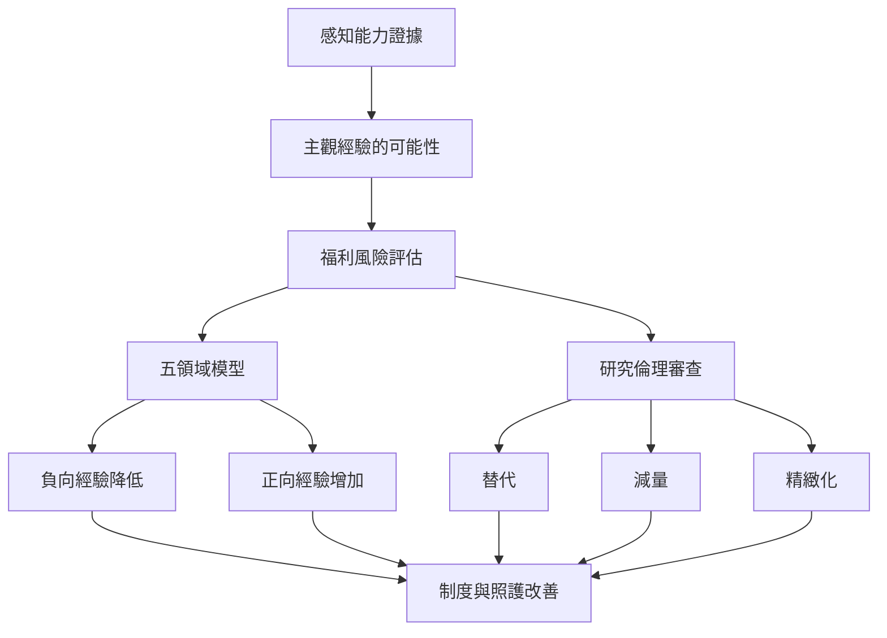

動物福利的科學評估需要從感知證據走向具體生活條件。感知研究提供動物是否可能具有主觀經驗的證據；五領域模型則把營養、環境、健康、行為與心理狀態轉為可操作的評估面向。研究倫理中的 3R 進一步把福利要求轉化為研究設計與機構程序。

核心筆記包括[[感知證據的不確定性應觸發審慎而非冷漠]]、[[良好動物福利同時包含免於痛苦與實現正向生活]]、[[研究使用動物的舉證責任應隨替代方案成熟而提高]]及[[動物倫理必須把魚類無脊椎動物與經濟動物納入視野]]。概念入口為[[感知能力]]、[[動物意識]]、[[動物福利]]、[[五大自由]]、[[五領域模型]]、[[3R原則]]與[[預防原則]]。並與[[道德地位與倫理理論]]、[[制度實踐與法律治理]]相連。
