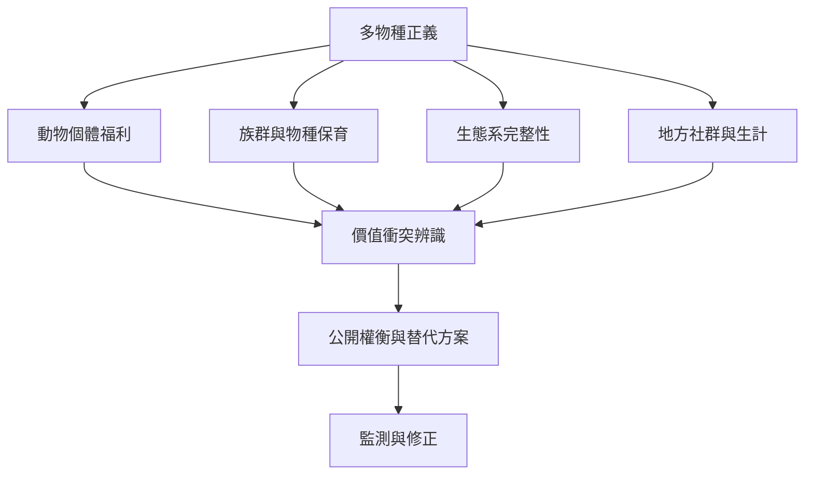

動物倫理的尺度不只個體，也包括社群、物種、生態系與人類地方社群。保育有時必須處理棲地破壞、入侵種、疾病、捕食者管理與人獸衝突；決策可能讓個體福利和族群／生態目標產生張力。多物種正義進一步要求同時檢視殖民歷史、土地權、地方知識與資源分配。

從[[動物個體利益與生態整體利益必須分開說明再權衡]]理解尺度差異，再閱讀[[保護動物不能忽略殖民歷史與人類社群的生計正義]]與[[跨文化動物倫理應避免把地方知識收編成單一普遍模型]]。相關研究包括[[野生動物福利與生物多樣性保育需要透明處理價值衝突]]、[[Ubuntu倫理可從動物社群的互助實踐擴大道德共同體]]及[[拉丁美洲法院正以憲法解釋擴展動物與自然的法律保護]]。概念入口為[[多物種正義]]與[[自然權利]]。並與[[關係倫理與跨文化思想]]、[[制度實踐與法律治理]]互相連結。
