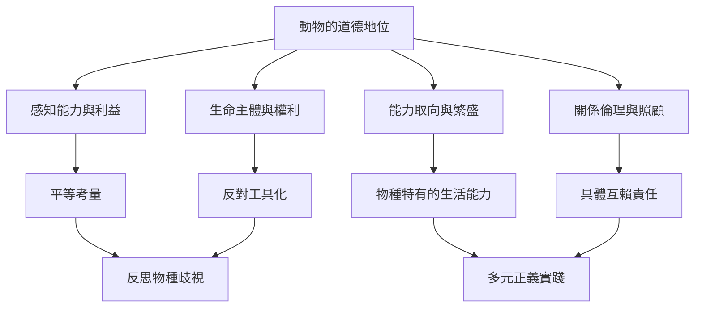

動物倫理的第一個問題是：哪些生命具有道德地位，以及人類對牠們負有何種直接義務。功利主義強調利益與痛苦的考量，權利論強調個體不應被當成工具，能力取向則關注生命是否有機會繁盛；關係倫理與德行倫理補充具體照顧與行動者品格的面向。

可由[[動物的道德地位不應由物種身分單獨決定]]、[[平等考量相似利益不要求所有生命受到相同待遇]]、[[福利改革與權利保障回答的是不同層次的倫理問題]]、[[能力取向主張正義應保障動物實現其生命可能性]]進入理論核心。再以[[動物倫理]]、[[動物權利]]、[[道德地位]]、[[物種歧視]]、[[平等考量]]、[[生命主體]]與[[能力取向]]整理概念。此圖與[[感知科學與福利評估]]、[[關係倫理與跨文化思想]]互相補足。
