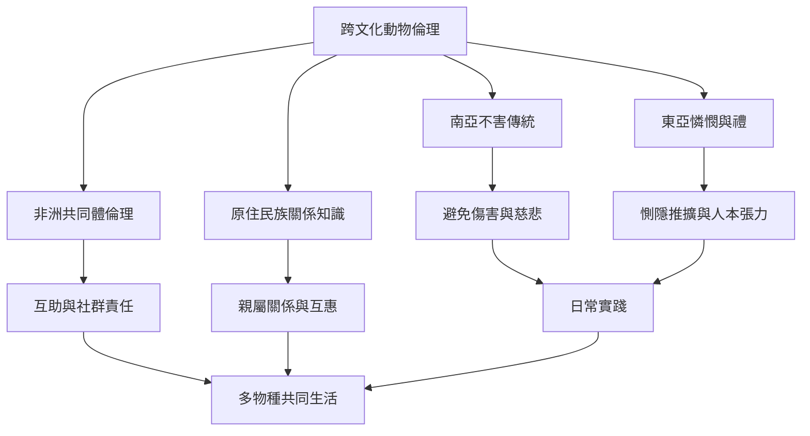

跨文化動物倫理讓我們看見普遍原則之外的關係、修行、共同體與地方知識。佛教與耆那教的不害思想強調避免傷害；孟子文本呈現由憐憫推擴關懷的可能，也暴露人本秩序的限制；Ubuntu、whakapapa 與部分原住民族觀點則重新思考共同體與親屬關係。比較的目的不是排列文化高下，而是揭示不同倫理資源與內部張力。

閱讀路徑可從[[跨文化動物倫理應避免把地方知識收編成單一普遍模型]]出發，接續[[佛教動物倫理以不害慈悲與苦的理解擴大關懷]]、[[耆那教不害戒律將避免傷害擴及各類生命]]、[[中國思想對動物的憐憫與人類中心秩序呈現複雜張力]]、[[Ubuntu倫理可從動物社群的互助實踐擴大道德共同體]]及[[原住民族動物倫理常以親屬關係與互惠責任理解動物]]。概念包含[[不害]]、[[佛教]]、[[耆那教]]、[[Ubuntu]]、[[whakapapa]]與[[關係倫理]]。並與[[道德地位與倫理理論]]、[[生態正義與保育衝突]]互相連結。
