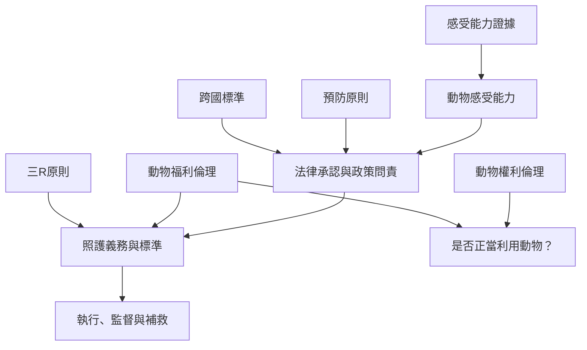

本圖呈現科學證據、感受能力、倫理立場、法律承認和執行制度的連結。承認感受能力是政策起點之一，並不等於動物已獲得完整權利或全面免於利用。

概念連結：[[Animal welfare law]], [[Animal sentience]], [[Animal rights]], [[Precautionary principle]], [[Three Rs]], [[全球標準只有連結執法能力才會改變動物處境]], [[承認動物感受能力會擴大人類的照護與政策責任]]。
