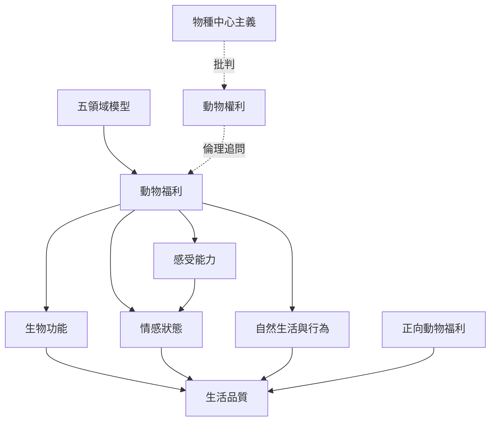

本圖以動物個體的生活經驗為核心，呈現健康、情緒、行為、正向福利與倫理立場間的關係。福利模型提供評估架構，但不會自動解決價值衝突。

概念連結：[[Animal welfare]], [[Animal sentience]], [[Five Domains Model]], [[Positive animal welfare]], [[Animal rights]], [[Speciesism]], [[動物福利必須同時關注個體經驗與生活條件]], [[動物福利不應只以避免痛苦作為終點]]。
