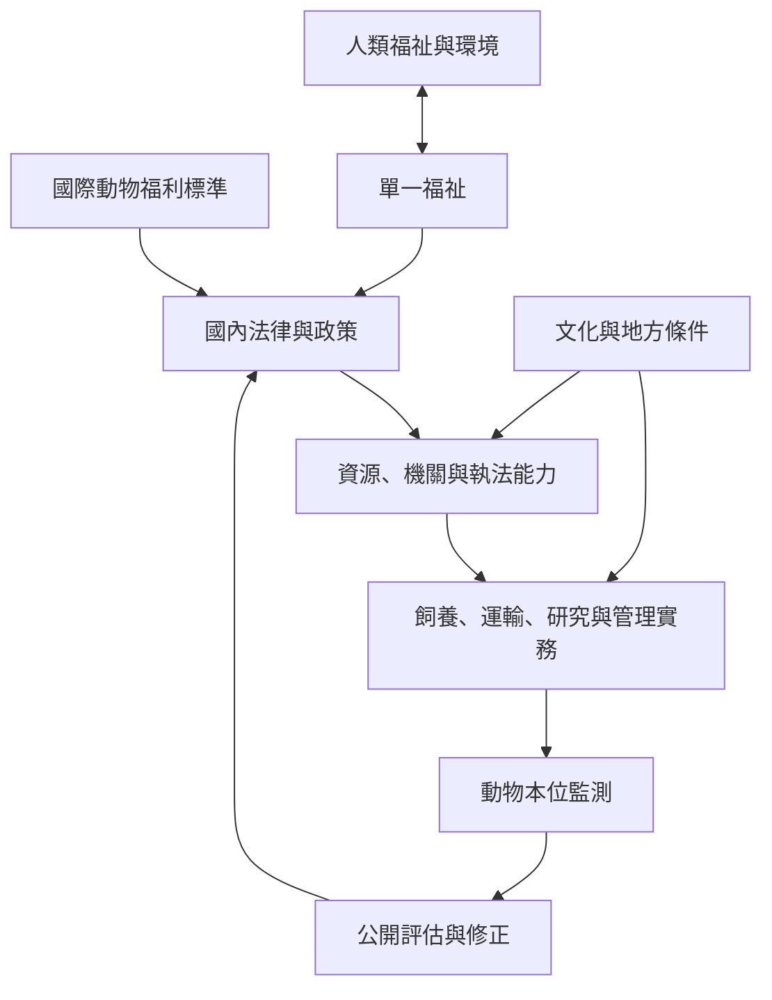

本圖聚焦福利改善如何從全球標準走向地方執行，再透過監測、社群合作和回饋更新政策。

概念連結：[[Animal welfare law]], [[One Welfare]], [[Animal-based measure]], [[Three Rs]], [[街犬治理是動物福利公共衛生與社區共存的共同問題]], [[動物福利政策需要讓公眾倡議轉化為可執行制度]], [[動物福利治理需要兼顧全球基準與地方條件]]。
