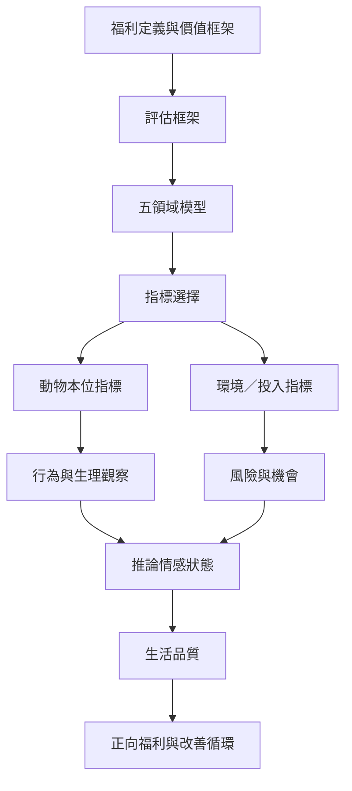

本圖區分動物生活條件、可觀察指標、心理狀態推論與累積生活品質，提醒評估工具需先定義福利，再驗證指標。

概念連結：[[Animal welfare science]], [[Animal-based measure]], [[Affective state]], [[Quality of life]], [[Five Domains Model]], [[福利評估應先把抽象的良好生活轉成可檢驗問題]], [[動物個體指標比飼養投入更接近牠的實際經驗]]。
