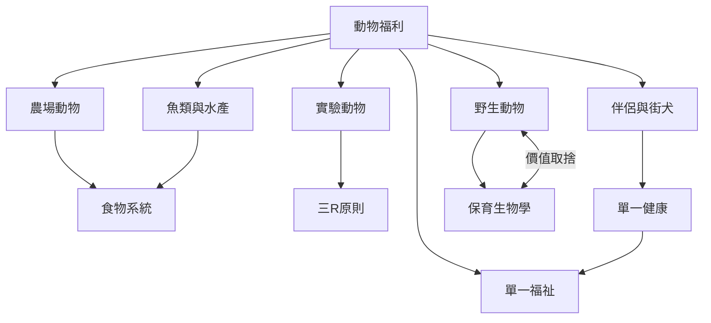

本圖將農場、水產、實驗、伴侶與野生動物納入同一福利視野，同時呈現 One Welfare、One Health 與保育科學的交集。

概念連結：[[One Welfare]], [[One Health]], [[Wild animal welfare]], [[Conservation biology]], [[Free-roaming dog management]], [[水產供應鏈必須把魚視為具有經驗的個體]], [[街犬治理是動物福利公共衛生與社區共存的共同問題]]。
