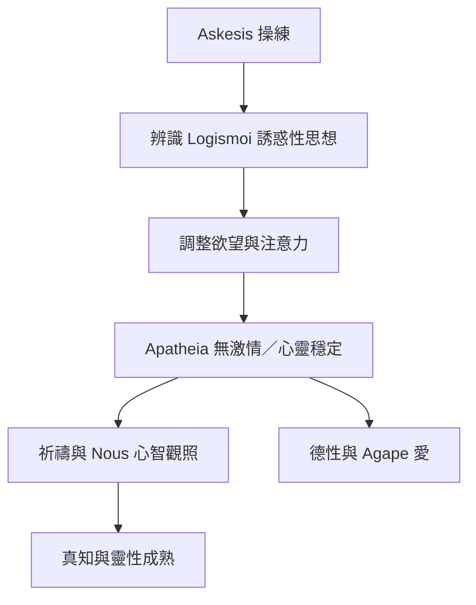

早期基督宗教修道傳統承接並改寫希臘哲學的無激情概念。伊瓦格里烏以八種 logismoi 描繪心念如何纏擾修行者，並把 apatheia 與真知、祈禱連在一起；後來的基督宗教思想則可把無激情置於愛、德性與神化的脈絡中。這條歷史不是單純搬用斯多葛理論，而是改變了它的宗教目的與靈魂觀。

參見 [[修道傳統把無激情發展為持續觀察心念的能力]]、[[愛可以是無激情修行的成果而不是它必須排除的對象]]、[[無激情既是修行方向也是逐步穩定的心靈狀態]]。術語：[[term/Logismoi]]、[[term/Askesis]]、[[term/Nous]]、[[term/Agape]]。
