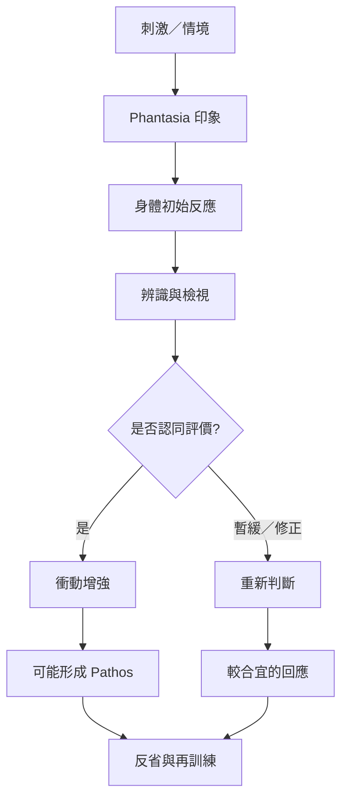

塞內卡與斯多葛心理學的分析，可用來拆解感受如何變成行動：印象可能自發出現，身體也會有非自願反應；但心靈是否認可印象中的評價，以及是否順從後續衝動，仍可被觀察與練習。這不是否認身體與情境，而是避免將第一反應視為不可改變的命令。

參見 [[初始感受可以自動出現而認同與行動仍有訓練空間]]、[[在感受與行動之間練習一個辨識空間]]、[[在衝突中區分事實判斷與價值判斷]]。術語：[[term/Phantasia]]、[[term/Sunkatathesis]]、[[term/Pathos]]。
