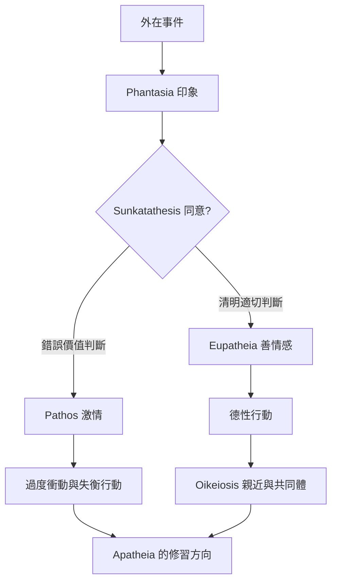

斯多葛式 *apatheia* 位於一個完整倫理心理系統中：外在事件形成印象，心靈對印象作出或不作出同意，判斷再引發衝動與行動。激情是錯誤或失衡的判斷—衝動，善情感則顯示理性仍能支持喜悅、善意與審慎。這套系統還以親近化（oikeiosis）說明人與他人的倫理關係。

可與 [[data/斯多葛派把激情理解為失衡的判斷與過度衝動]]、[[data/斯多葛派的善情感證明無激情不等於冷漠]]、[[data/斯多葛學者訪談指出斯多葛主義的核心不是情緒管制]]、[[斯多葛派把激情理解為失衡的判斷與過度衝動]]、[[激情不是情緒本身而是被錯誤評價帶動的失衡衝動]]、[[善情感讓理性與關懷得以共同存在]] 一起閱讀。核心術語為 [[term/Apatheia]]、[[term/Pathos]]、[[term/Phantasia]]、[[term/Sunkatathesis]]、[[term/Eupatheia]]、[[term/Oikeiosis]]。
