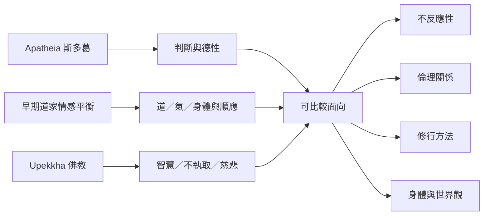

Apatheia、道家情感平衡與佛教 upekkhā 都可以和「平靜」或「平等心」對話，但它們各自依附不同的身體觀、心理學、倫理學與終極目標。跨文化比較應先釐清每個傳統內部的概念位置，再看它們在注意力調節、不反應性與倫理回應上有哪些功能相似。

參見 [[跨文化比較應先比較修行功能再比較相似詞彙]]、[[道家情感平衡重視靈活回應而不只是減少情緒]]、[[佛教平等心以智慧與慈悲為支撐而非情感中性]]。術語：[[term/Apatheia]]、[[term/Upekkha]]、[[term/Dao]]。
