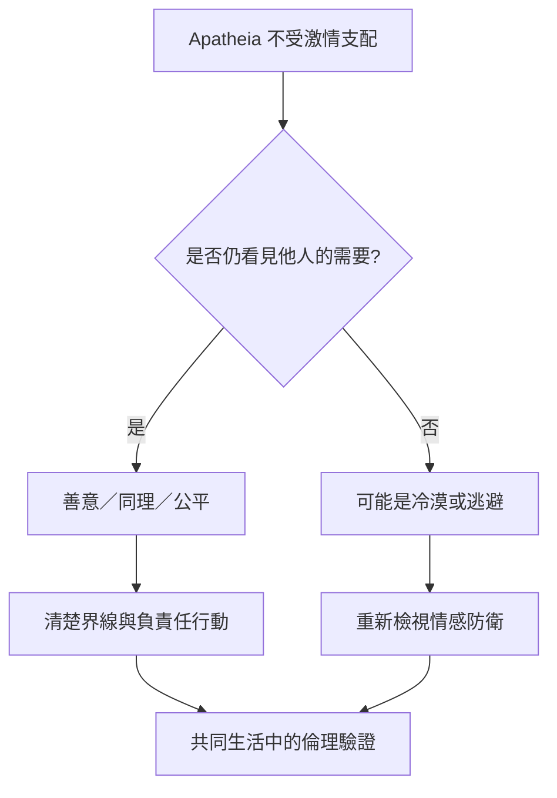

無激情的核心難題是如何避免兩個相反的錯誤：一方面被恐懼、憤怒或欲望支配；另一方面又把不反應誤解為冷漠、逃避與不作為。斯多葛的善情感、oikeiosis 及基督宗教的 agape 提供資源，提醒理性自由應能支持善意、照顧與負責任的行動。

參見 [[理性平靜必須保留對他人的倫理責任]]、[[善情感讓理性與關懷得以共同存在]]、[[把無激情轉化為可親近的關懷能力]]、[[用共同生活檢驗哲學上的無激情]]。術語：[[term/Eupatheia]]、[[term/Oikeiosis]]、[[term/Agape]]。
