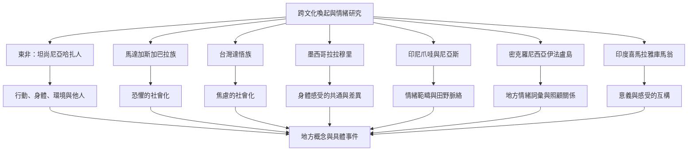

這張概念地圖整理來自東非、馬達加斯加、台灣、墨西哥、印尼、密克羅尼西亞與印度喜馬拉雅的情緒研究。研究設計包括事件敘事訪談、長期田野民族誌、身體感受比較及地方詞彙分析。它們共同提醒：喚起與情緒的經驗不只由個體內部狀態構成，也需要放進行動、身體、語言、照顧關係與生活環境理解。以下案例不能代表整個國家或大洲，而是具體社群與研究情境中的觀察。

## 延伸筆記
- [[跨文化情緒研究應從地方概念與生活實踐出發]]
- [[文化差異是群體趨勢不是個人本質]]
- [[身體訊號需要經內感受與情境解釋才成為情緒]]
- [[墨西哥拉拉穆里與印尼爪哇人的情緒身體感受呈現共通與差異]]
- [[坦尚尼亞哈扎人的情緒敘事更重視行動身體與環境]]
