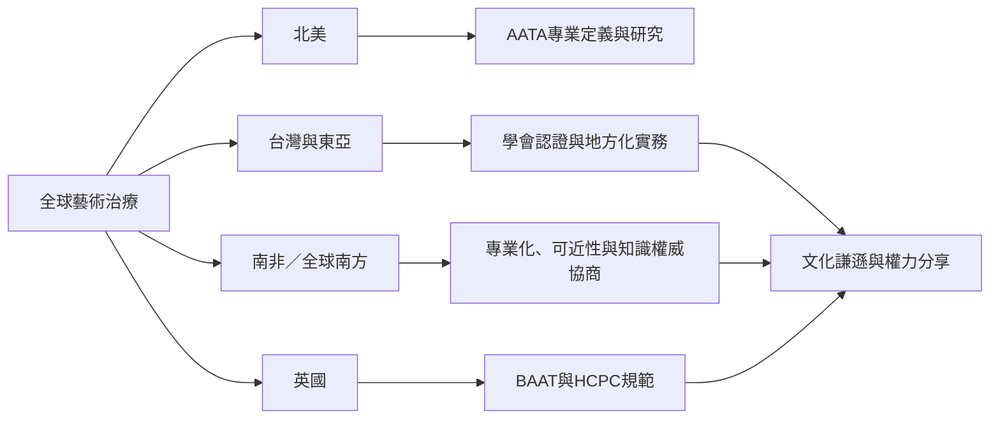

全球比較不能只把英美專業模式當作中心。台灣的學會認證、英國的法定職稱規範、日本的地方化敘事、亞洲跨國案例與南非正在協商的專業化，呈現不同制度與知識傳統交會的方式。

亞洲書籍收錄台灣、香港、日本、韓國、柬埔寨、泰國、中國、印度與新加坡等案例；日本與南非的近期研究進一步提醒，地方工作者的聲音可能彼此不同。地圖應被視為開放索引，未有來源的地區不可假裝已被代表。

來源連結：[[亞洲藝術治療案例呈現西方模式在地轉化的多樣性]]、[[日本臨床心理中的藝術治療呈現地方化與關係修復敘事]]、[[南非藝術治療專業化仍在協商形成]]、[[台灣藝術治療師認證呈現專業化與持續教育要求]]。

概念連結：[[文化謙遜]]、[[在地化]]、[[去殖民實務]]、[[權力分享]]。

行動連結：[[採訪在地藝術治療師時同時記錄制度與日常工作]]、[[以地方工藝與日常材料共創而非複製通用模板]]。

回到 [[Art_therapy]]。
