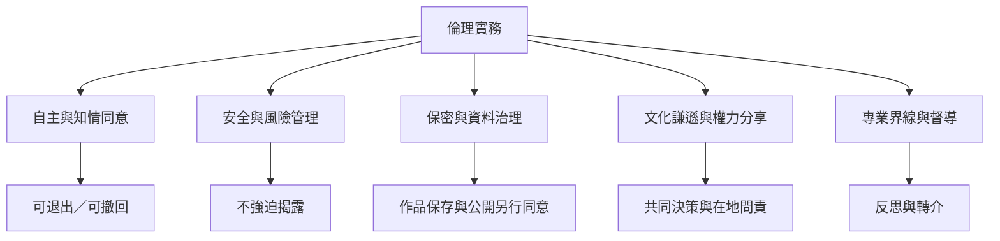

藝術治療的倫理不是創作結束後才補上的文件，而是從招募、目標設定、材料選擇、創作、紀錄、展示、研究到結束服務都持續運作。核心問題包括當事人是否真正能選擇、是否明白資料用途、是否能拒絕分享，以及專業者如何處理權力差距。

此圖可用於社群活動的倫理檢核，但不取代專業法規、機構政策與督導。

概念連結：[[知情同意]]、[[保密]]、[[文化謙遜]]、[[權力分享]]、[[去殖民實務]]。

永久筆記：[[藝術作品也是高度敏感的個人資料]]、[[文化謙遜要求工作者分享權力而非輸出標準答案]]。

靈感連結：[[以共同策展練習探索作品所有權與同意]]、[[把不創作的選擇納入藝術活動的可近性設計]]。

回到 [[Art_therapy]]。
