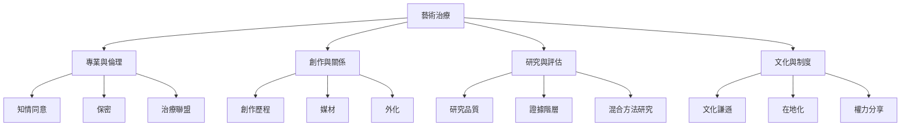

藝術治療可從四個彼此交織的層面理解：專業與倫理、創作與關係、研究與評估、文化與制度。任何一個面向都不能獨立代表整個領域。專業資格建立安全底線；創作與治療聯盟構成工作歷程；研究協助檢視成效與限制；文化脈絡則決定方法如何被理解與實踐。

閱讀時可從 [[藝術治療]] 與 [[藝術心理治療]] 開始，再沿著 [[治療聯盟]]、[[創作歷程]]、[[研究品質]] 與 [[文化謙遜]] 展開。這張地圖是概念導覽，不是對療效的因果模型。

相關永久筆記：[[藝術治療的核心不是作品漂亮而是創作關係與心理歷程]]、[[藝術治療與一般藝術參與必須分開討論]]、[[藝術治療研究需要同時呈現有效性與不確定性]]、[[藝術治療專業化受地方制度與歷史條件影響]]。

相關靈感：[[建立藝術治療研究閱讀卡以避免把不同介入混為一談]]、[[採訪在地藝術治療師時同時記錄制度與日常工作]]。

回到 [[Art_therapy]]。
