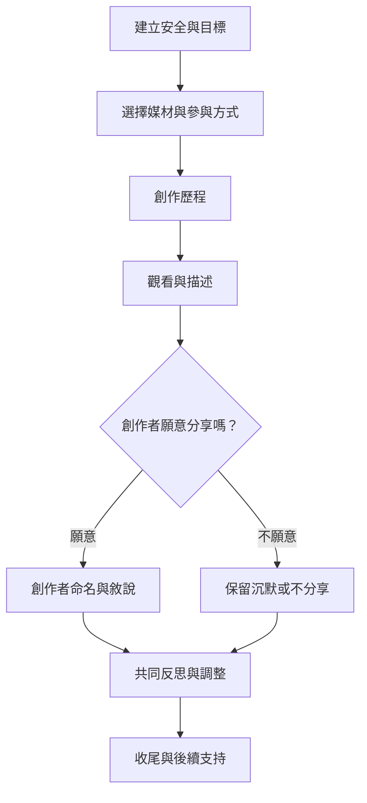

創作歷程可以包含抵達、選擇媒材、創作、觀看、命名、分享、反思與收尾。每一個階段都需要選擇權與節奏調整；作品只是一項工作材料，不是自動透明的心理診斷。

這張圖刻意讓「不分享」成為正式路徑。流程應依服務族群、文化、材料與風險調整，不可當成所有人的固定處方。

概念連結：[[創作歷程]]、[[媒材]]、[[治療聯盟]]、[[非語言表達]]、[[外化]]、[[知情同意]]、[[創傷知情照護]]、[[共同見證]]。

永久筆記：[[作品不能脫離創作者脈絡而被解碼]]、[[創傷知情的創作應由安全感與選擇權帶領]]、[[媒材選擇會改變創作歷程與參與門檻]]。

靈感連結：[[設計可退出可旁觀的團體創作流程以提高安全感]]、[[以創作者自我命名取代帶領者解讀作品的工作坊]]。

回到 [[Art_therapy]]。
