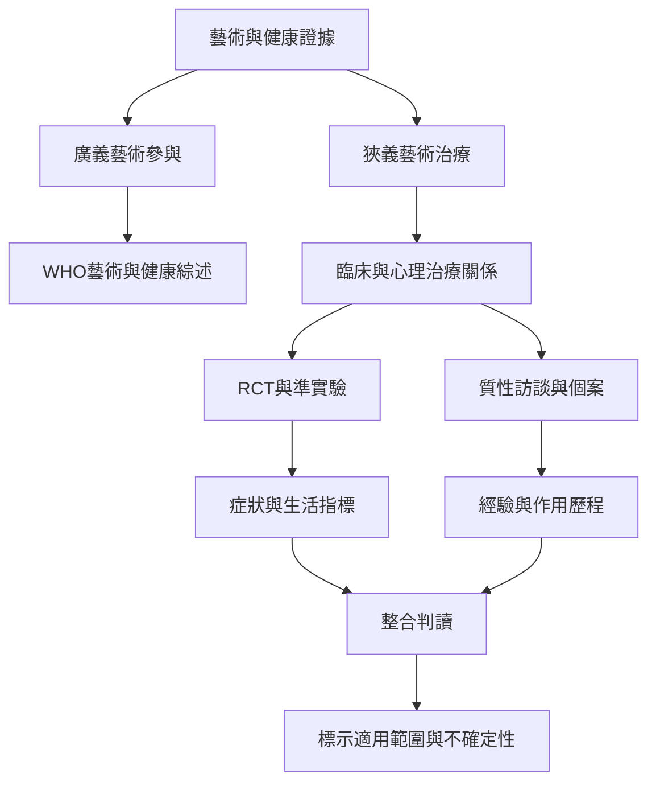

藝術治療的證據分布在不同族群與情境，從心理健康、創傷、神經發展到癌症照護。最重要的閱讀步驟，是先確認研究究竟測量「專業藝術治療」還是更廣義的藝術本位介入，再比較樣本、對照、結果與偏差風險。

重要來源包括 [[WHO統整藝術參與與健康福祉的跨領域證據但不等同藝術治療]]、[[2024統合分析顯示主動視覺藝術治療的成效跨研究高度異質]]、[[2026統合分析報告藝術治療與心理福祉憂鬱焦慮及認知的關聯]]、[[難民兒少藝術治療證據具潛力但現階段仍不足]] 與 [[自閉症兒少藝術治療系統性回顧指出非語言與感官關係面向]]。

概念連結：[[藝術與健康]]、[[研究品質]]、[[證據階層]]、[[混合方法研究]]。

行動連結：[[建立藝術治療研究閱讀卡以避免把不同介入混為一談]]。

回到 [[Art_therapy]]。
