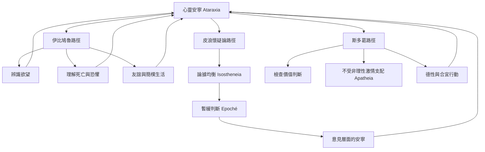

Ataraxia 並非只屬於單一學派。伊比鳩魯學派從欲望、死亡恐懼與友誼切入；皮浪懷疑論從論據均衡與暫緩判斷切入；斯多葛派則由德性、價值判斷與激情管理切入。三條路徑都關心心靈如何不再被錯置的依賴與判斷支配。

這張圖不是把三派整理成同一套技巧，而是呈現它們各自如何處理擾動來源。延伸比較 [[心靈平靜可由改變判斷欲望或反應習慣而養成]]、[[欲望縮減比無限滿足更能支持持久安樂]] 與 [[暫緩判斷能降低意見衝突帶來的情緒負荷]]。
