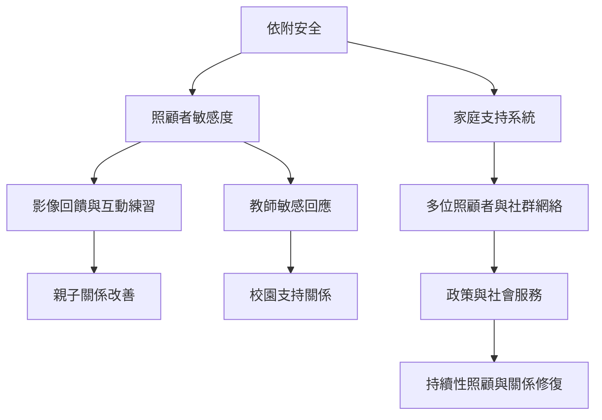

依附研究的應用價值，在於改善照顧關係的回應性與穩定性，並建立讓照顧者可持續工作的社會條件。介入成效應依不同目標分別評估，不以單一標籤或單一分數概括。

概念連結：[[依附導向介入]]、[[照顧者敏感度]]、[[依附安全]]、[[依附網絡]]、[[心智化]]。

延伸閱讀：[[依附介入應改善照顧互動而非貼標籤]]、[[為照顧者建立可持續的支持網絡]]、[[將照顧敏感度轉化為可練習微行動]]、[[以修復經驗累積關係安全]]。
