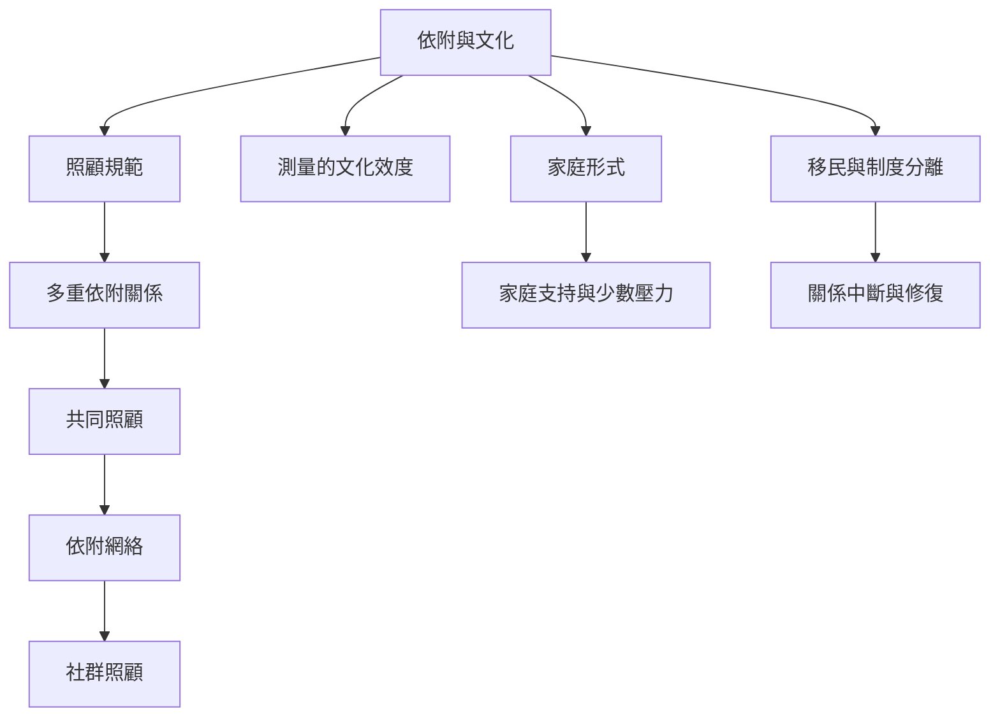

依附關係總在特定家庭、文化與制度中形成。跨文化比較應同時檢視照顧功能與表現形式，並把親族、社群、移民政策及家庭多樣性納入分析。

概念連結：[[依附與文化]]、[[多重依附關係]]、[[共同照顧]]、[[依附網絡]]、[[心智化]]。

延伸閱讀：[[跨文化研究需要區分功能與表現形式]]、[[社群照顧挑戰親子二元依附框架]]、[[創傷與分離需要結合社會制度理解]]、[[家庭組成不決定依附品質]]。
