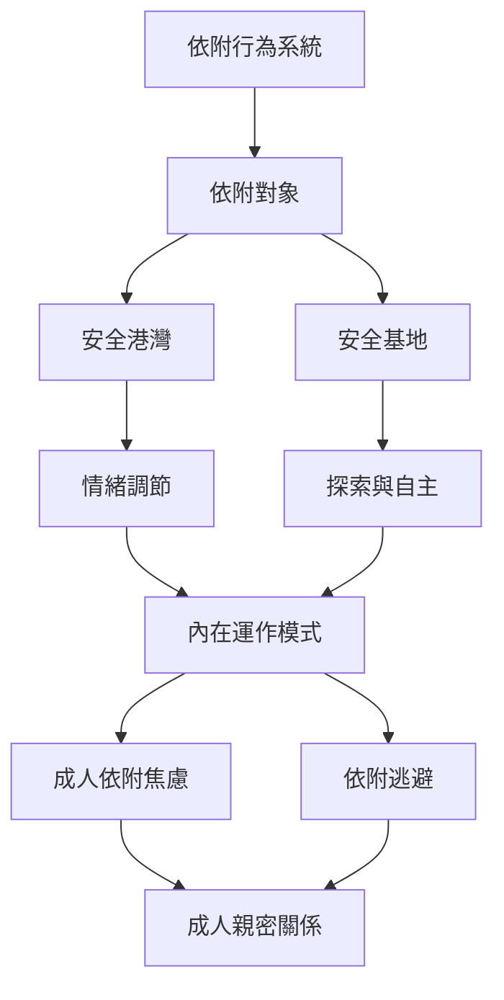

依附理論的核心不是分類表，而是理解人在壓力下如何尋求關係支持，以及安全感如何支持探索。此圖從依附行為系統連到安全港灣、安全基地與內在運作模式，再延伸到成人關係。

概念連結：[[依附]]、[[依附行為系統]]、[[安全基地]]、[[安全港灣]]、[[內在運作模式]]、[[依附安全]]。

延伸閱讀：[[依附是接近照顧者以管理威脅的行為系統]]、[[安全基地讓探索與返回形成互補]]、[[依附安全同時具有延續性與可變性]]。
