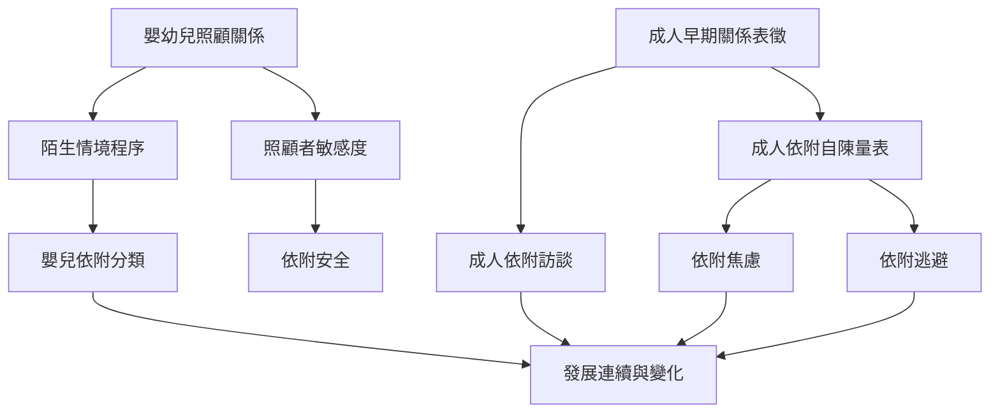

依附研究透過觀察與訪談將關係過程轉化為資料，但不同工具測量的層次並不相同。閱讀此領域時，需把發展階段、關係對象、測量方式與分類解釋放在一起。

概念連結：[[陌生情境程序]]、[[成人依附訪談]]、[[依附安全]]、[[照顧者敏感度]]、[[依附焦慮]]、[[依附逃避]]、[[依附混亂]]。

延伸閱讀：[[依附測量是操作化模型不是關係全貌]]、[[依附類型描述關係中的策略而非人格本質]]、[[成人依附在不同關係中可呈現不同樣貌]]。
