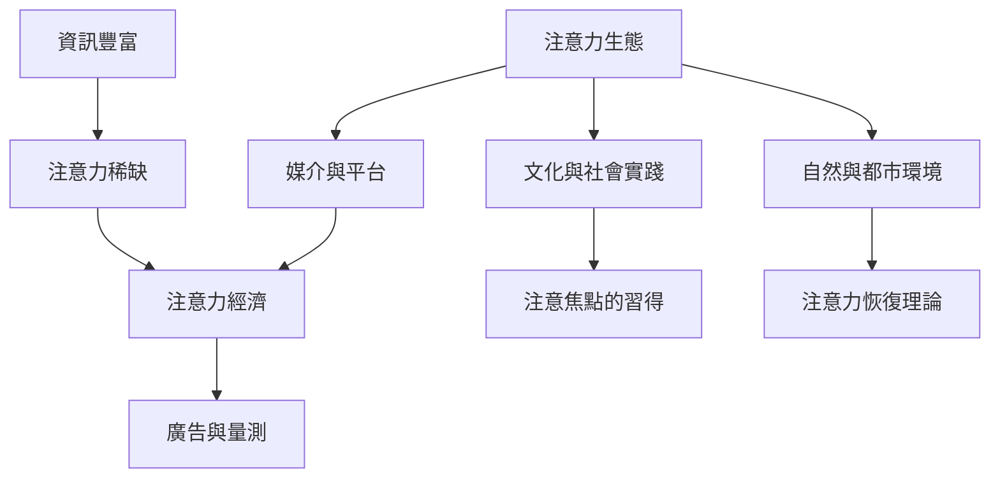

注意力不只由個人意志決定。自然與都市環境提供不同感官要求；文化實踐讓人學會注意焦點；平台以演算法與商業指標安排可見性；資訊豐富的環境使注意成為稀缺資源。注意力生態觀把個人習慣、空間設計、媒介制度與商業誘因放在同一張圖中。

概念入口：[[注意力生態]]、[[注意力經濟]]、[[注意力恢復理論]]、[[由上而下注意]]、[[由下而上注意]]、[[具身認知]]。

延伸閱讀：[[資訊愈豐富注意力愈成為稀缺資源]]、[[平台把注意力經營轉為個人化的數位商品]]、[[文化實踐可能塑造人們注意物件或情境的方式]]、[[自然環境可能暫時恢復定向注意力]]。本圖屬於 [[Attention]] 書庫。
