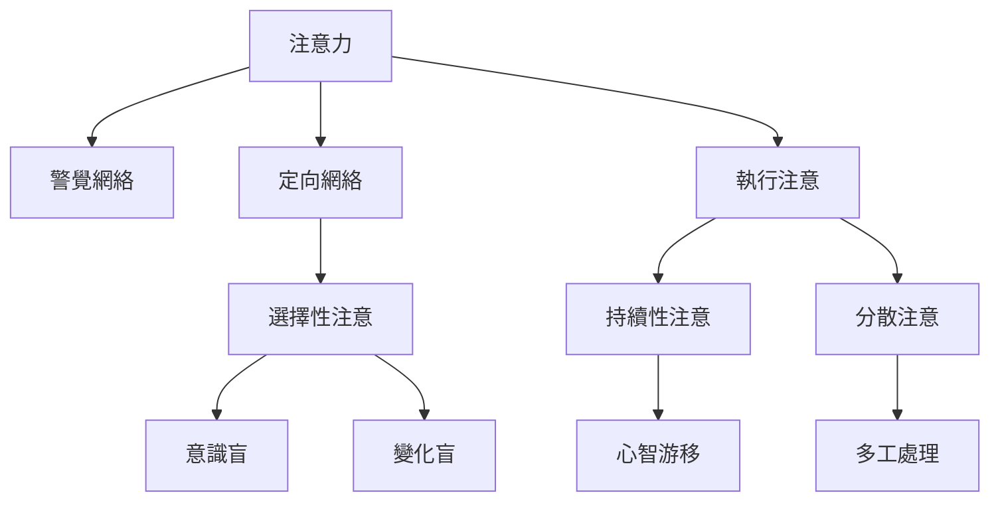

注意力研究可先由功能區分開始：警覺讓心智準備好回應，定向選擇要處理的刺激，執行注意協調目標與衝突。選擇性處理使行動得以聚焦，卻也產生意識盲與變化盲。多工與心智游移則提醒我們，注意的維持與轉換都具有成本，也可能有適應性用途。

概念入口：[[注意力]]、[[警覺網絡]]、[[定向網絡]]、[[執行注意]]、[[選擇性注意]]、[[持續性注意]]、[[分散注意]]、[[意識盲]]、[[變化盲]]、[[心智游移]]、[[多工處理]]。

延伸閱讀：[[注意力由警覺定向與執行控制等網絡共同支持]]、[[注意力的選擇會造成意識盲與變化盲]]、[[多工會帶來任務切換與認知處理成本]]。本圖屬於 [[Attention]] 書庫。
