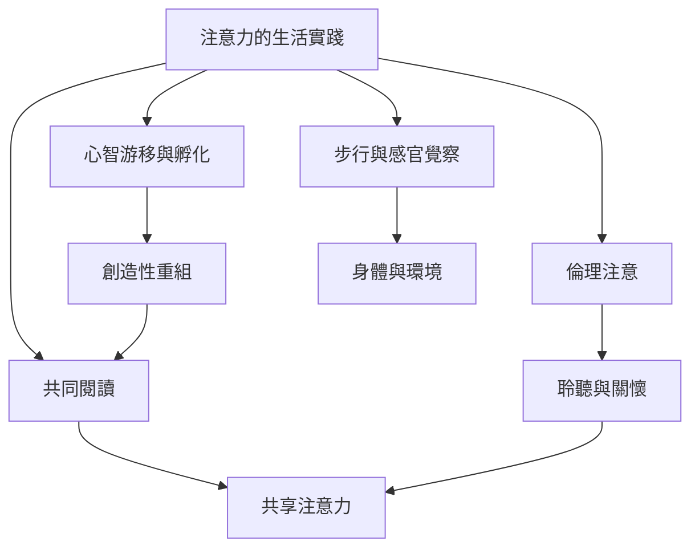

注意力可以是對他人的倫理性看見，也可以成為創造性思考的孵化條件。真正的聆聽需要暫緩自我中心的解釋；休息與游移則可能為思緒重組留出空間。這些實踐都提醒我們，注意不必永遠被效率指標衡量，而可以服務於關係、理解與共同生活。

概念入口：[[心流]]、[[心智游移]]、[[具身認知]]、[[注意力]]。

延伸閱讀：[[注意他人可以成為倫理性的看見與關懷]]、[[心智游移對創造力的影響取決於任務與覺察]]、[[把一天設計成不同注意力品質交替的節奏]]、[[讓共同閱讀成為共享而非競逐注意力的空間]]。本圖屬於 [[Attention]] 書庫。
