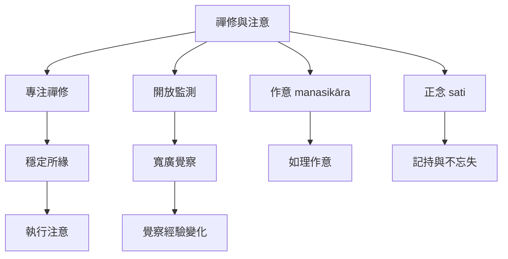

禪修中的注意力不是單純增加集中強度。專注注意以選定對象練習穩定與返回；開放監測則培養對經驗變化的寬廣覺察。早期佛教的作意與正念有不同功能，而如理作意進一步關注注意的方向與理解方式。這些概念可以互相參照，但不宜直接等同現代心理學術語。

概念入口：[[正念]]、[[作意]]、[[如理作意]]、[[專注禪修]]、[[開放監測]]、[[注意力]]。

延伸閱讀：[[早期佛教區分作意與正念的功能]]、[[專注冥想與開放監測可能以不同路徑訓練注意力]]、[[禪修教師將注意力練習延伸到日常感官經驗]]。本圖屬於 [[Attention]] 書庫。
