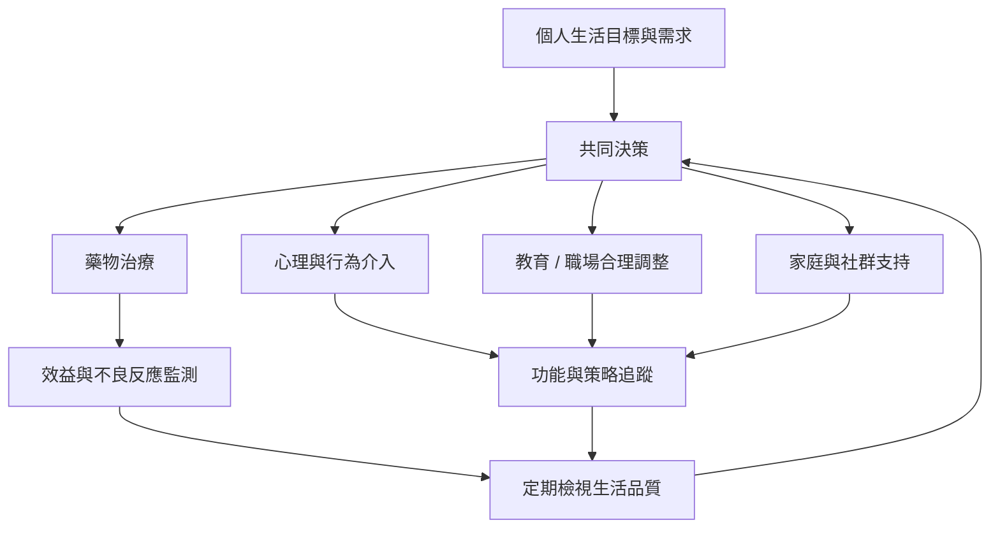

ADHD 照護不是單一治療方法的競賽，而是依年齡、共病、風險、生活目標及個人偏好組合藥物、心理介入、教育／職場調整與日常支持。應同時看短期療效、生活功能、可接受性、副作用與長期證據確定性。

核心連結：[[共同決策]]、[[藥物治療]]、[[生活品質]]、[[合理調整]]、[[環境支持]]、[[情緒調節]]。

證據與案例：[[英國NICE建議以共同照護計畫連結心理教育與職場學校支持]]、[[澳洲ADHD指引把生活品質文化安全與個人優勢納入照護]]、[[2025年治療證據總覽支持部分短期療效但長期證據仍有限]]、[[成人ADHD介入比較研究需要同時檢視療效與可接受性]]。

延伸實踐：[[把ADHD支持設計成任務與環境之間的配適工程]]、[[外部化提醒與流程能減少把困難歸咎於意志力]]、[[建立以本人生活目標為核心的療效日誌]]。

本書總覽：[[Attention_deficit_hyperactivity_disorder]]。
