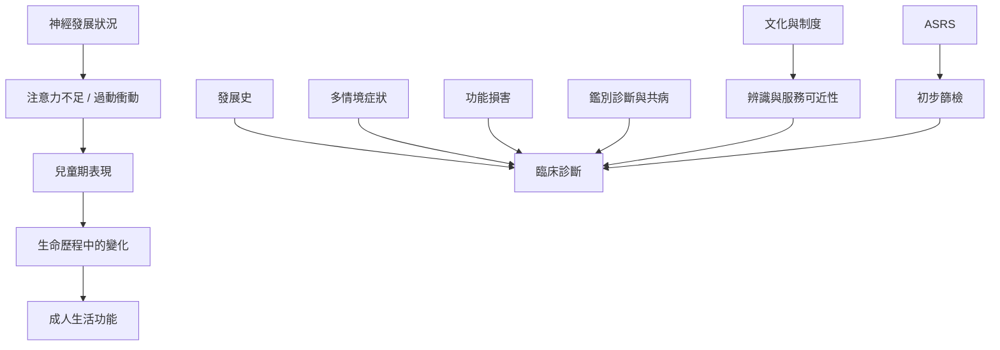

ADHD 應從生命歷程理解：診斷將症狀發展史、跨情境表現與功能影響連在一起；成人與女性的表現可能較隱性，且共病、睡眠與文化脈絡會改變辨識路徑。讀圖時，先分清楚臨床診斷、篩檢工具與人口統計各自回答的問題。

核心連結：[[注意力不足過動症（ADHD）]]、[[神經發展狀況]]、[[注意力不足]]、[[過動]]、[[衝動]]、[[臨床診斷]]、[[成人ADHD自評量表（ASRS）]]、[[共病]]、[[鑑別診斷]]、[[注意力表現會受到任務特性與環境線索調節]]、[[女性與安靜型表現可能被外顯過動偏誤漏診]]。

證據與案例：[[2026年世界ADHD共識更新以跨國實證重新校準公共理解]]、[[全球疾病負擔估計必須連同診斷與資料品質限制閱讀]]、[[成人ADHD盛行率會因持續症狀與當下症狀定義而不同]]、[[ADHD診斷應整合發展史跨情境症狀與功能損害]]、[[台灣成人ADHD健保研究呈現低就醫比例但不能代表人口盛行率]]。

本書總覽：[[Attention_deficit_hyperactivity_disorder]]。
