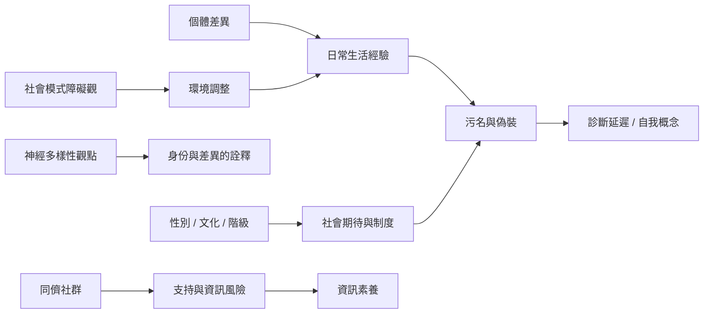

ADHD 經驗由神經認知特徵、個人生命史、家庭關係、學校與工作制度、文化規範及服務可近性共同形塑。第一人稱敘事能揭示診斷延遲、偽裝、污名與社群支持；神經多樣性與社會模式則提供重新設計環境的語言，但必須避免浪漫化困難或否定醫療需求。

核心連結：[[神經多樣性]]、[[社會模式障礙觀]]、[[偽裝]]、[[共病]]、[[合理調整]]、[[環境支持]]、[[文化與制度會影響ADHD被辨識的機會]]。

證據與敘事：[[成人ADHD第一人稱研究揭示診斷延遲與日常生活的複雜性]]、[[女性ADHD常因性別刻板印象與偽裝而延遲辨識]]、[[ADHD線上社群能提供歸屬感也可能放大錯誤訊息]]、[[台灣成人ADHD臨床衛教強調隱性困難與完整評估轉介]]。

延伸實踐：[[第一人稱訪談應保留矛盾經驗而不塑造單一ADHD故事]]、[[跨文化ADHD資料庫應同時記錄症狀語言與制度背景]]、[[讓ADHD社群以來源標記維持支持與資訊可靠度]]。

本書總覽：[[Attention_deficit_hyperactivity_disorder]]。
