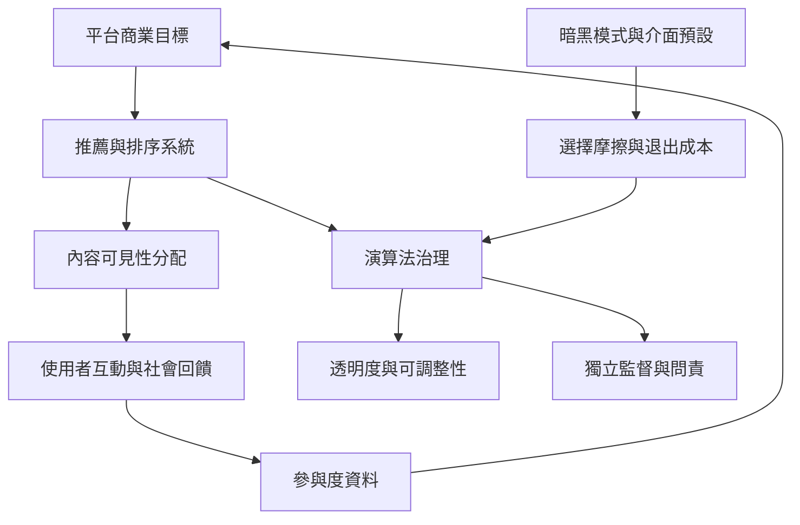

這張地圖關注平台如何分配可見性、塑造情緒回饋，並透過介面與資料流程影響使用者選擇。政策部分比較中國演算法推薦規定、歐盟 DSA、美國 FTC 暗黑模式報告，以及對監管可行性的研究。法規文本、執行狀況與治理效果必須分開評估。

## 核心筆記
* [[推薦系統同時分配資訊與社會可見性]]
* [[平台回饋機制會塑造可見的情緒規範]]
* [[小型中斷會累積成重新進入任務的成本]]
* [[演算法治理需要從告知走向可用的退出與替代選項]]
* [[法律與商業制度共同形塑注意力市場]]
* [[平台治理不能把所有責任交給使用者自律]]
* [[注意力治理需要公眾信任與可問責制度]]

## 概念連結
[[推薦系統]]、[[演算法策展]]、[[說服性科技]]、[[暗黑模式]]、[[監視資本主義]]、[[資料殖民]]、[[平台治理]]。
