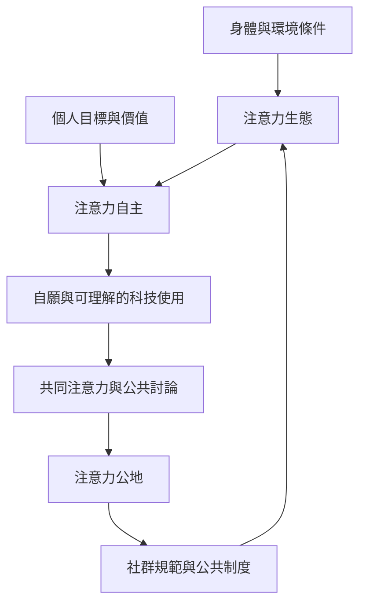

這張地圖將注意力從個人自律問題擴展為環境與集體照顧問題。注意力生態學讓我們觀察身體、空間、媒介及社會關係；注意力自主則關心科技是否服務人的目標；注意力公地則把共同理解、公共討論與社群規範視為需要維護的資源。

## 核心筆記
* [[注意力生態必須同時考慮個人與環境]]
* [[注意力自主不等於完全拒絕科技]]
* [[共同注意力是一種可以被照顧的公共資源]]
* [[數位服務的成功指標應包含完成目的而非延長停留]]
* [[全球南方的數位經驗需要在地脈絡而非單一敘事]]
* [[注意力治理需要公眾信任與可問責制度]]

## 概念連結
[[注意力生態學]]、[[注意力自主]]、[[注意力公地]]、[[公共領域]]、[[具身認知]]、[[數位公民素養]]。
