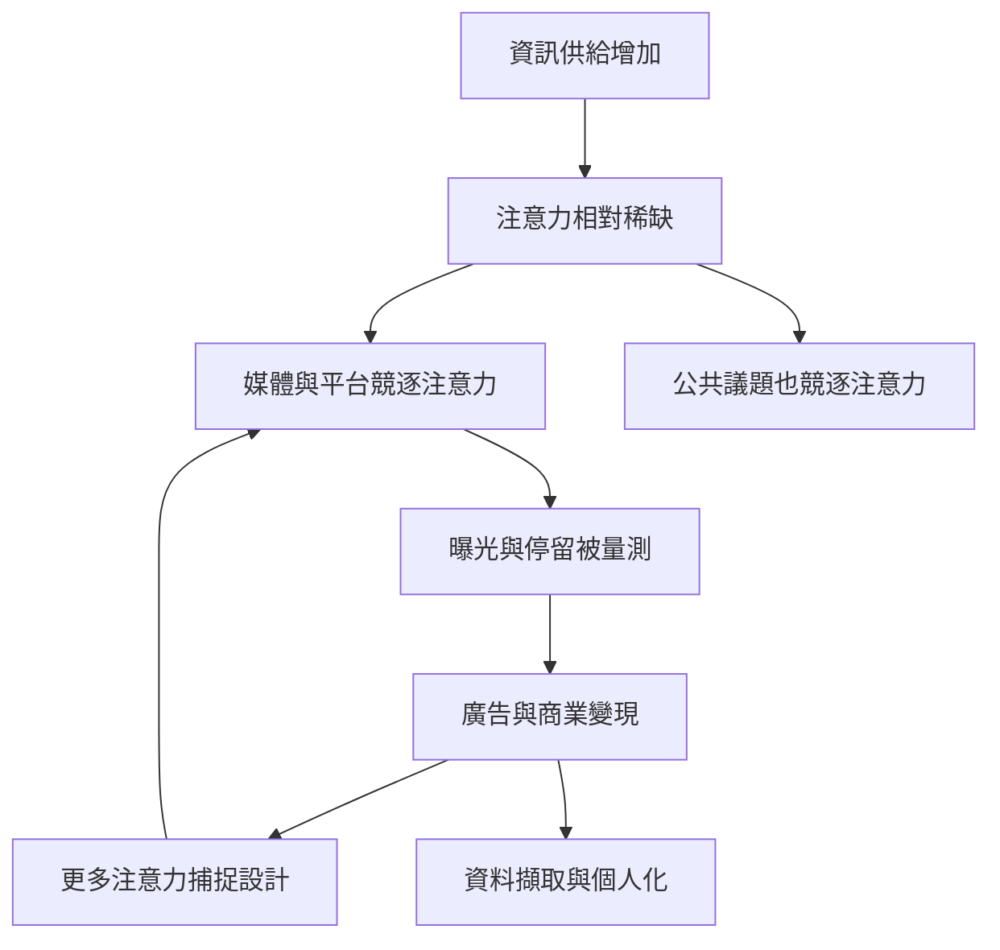

這張地圖從資訊稀缺轉向注意力稀缺，整理注意力如何成為市場競逐的資源，以及商業平台如何把曝光、時間與互動轉化為收入。核心問題不是單純的螢幕時間，而是資訊供給、注意力容量、廣告市場與公共利益之間的關係。

## 核心筆記
* [[注意力稀缺使資訊接收端成為新的經濟瓶頸]]
* [[注意力市場把人的時間轉換為可出售的廣告接觸]]
* [[注意力商業模式早於社群媒體]]
* [[平台停留時間不能直接代表使用者獲得價值]]
* [[公共討論必須與商業訊息競爭注意力]]
* [[資料擷取與注意力變現是相互強化但不同的機制]]

## 概念連結
[[注意力]]、[[注意力經濟]]、[[注意力商人]]、[[廣告]]、[[注意力資本主義]]、[[參與度指標]]、[[平台資本主義]]。
