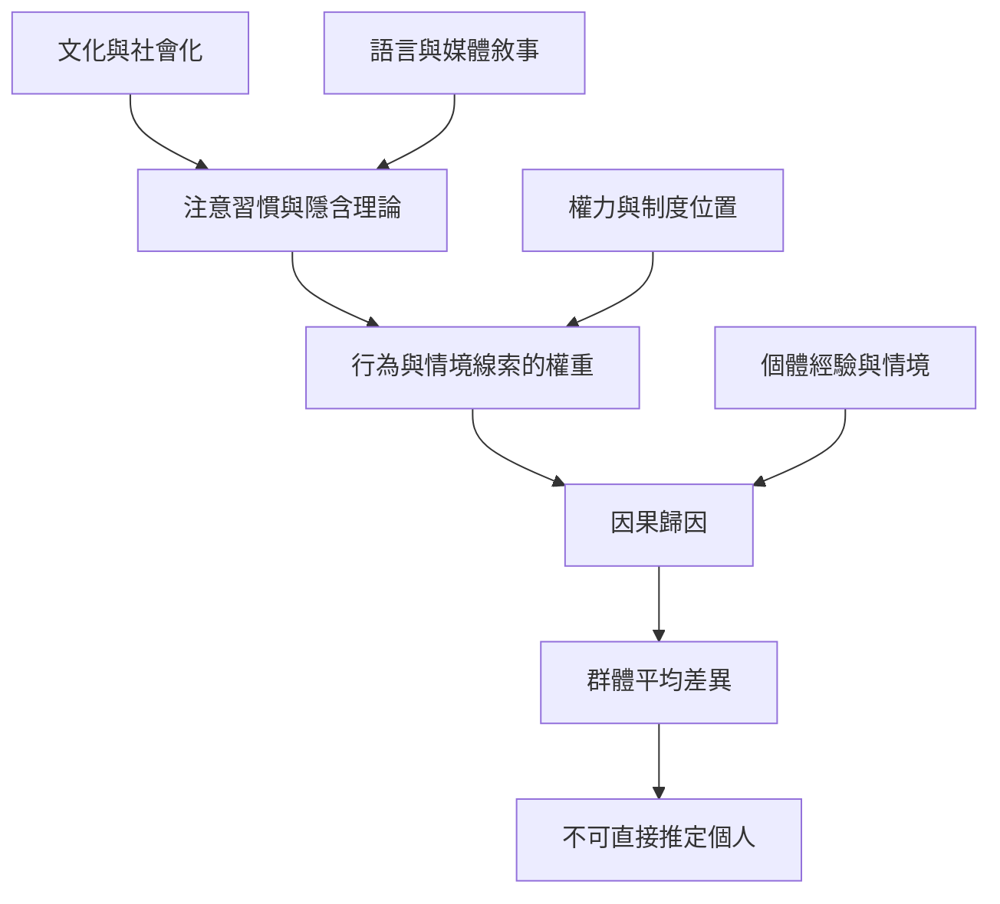

跨文化歸因研究顯示，對個人特質與情境因素的注意權重可能隨社會化、語言、媒體與任務條件而變化。中美、日本與美國、印度與加拿大、智利與美國，以及多國比較研究，呈現出共通與差異並存的圖像。台灣研究也指出，情境敏感不等於固定偏向情境歸因。

文化應被理解為影響歸因機率的脈絡，而不是替個體預先寫好的答案。研究者也必須檢查是否對不同族群使用一致的解釋標準。

## 參考
* [[文化心理學]]、[[整體式認知]]、[[分析式認知]]、[[情境歸因]]。
* [[跨文化研究指出中美對社會行為因果的注意重心不同]]、[[東西方歸因差異是情境敏感度差異而非一方沒有特質觀]]、[[五國研究顯示因果維度大致共通但印度評分不同]]。
* [[智利與美國的成就歸因結構相似但維度評分微異]]、[[日本與美國對社會強制情境的態度推斷呈現差異]]、[[台灣研究提醒華人情境敏感不等同永遠偏向情境歸因]]。
* [[文化歸因必須對不同群體採取一致標準]]、[[歸因研究必須把群體平均與個人判斷分開]]。
