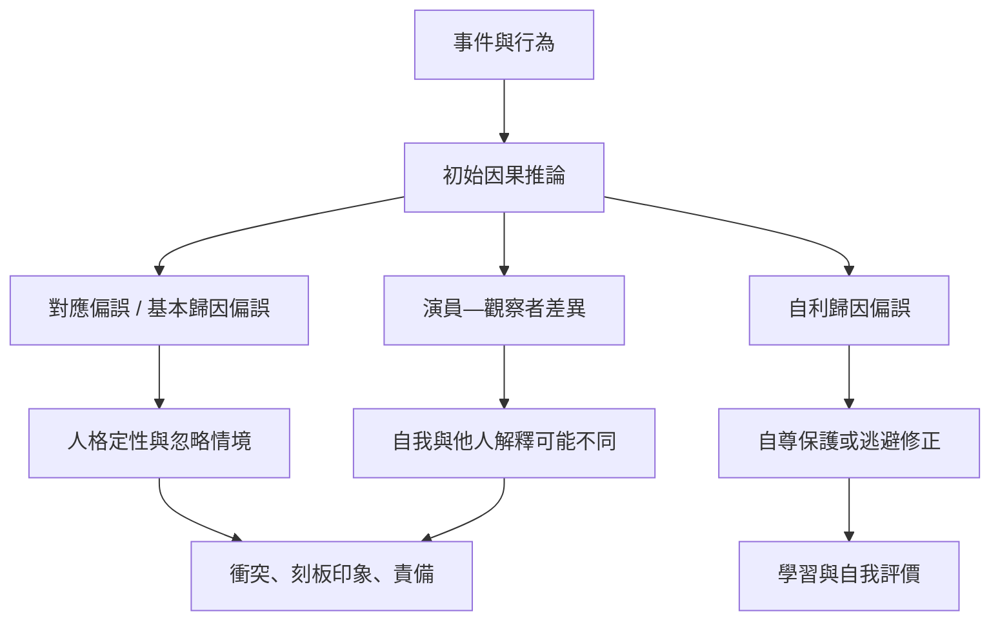

歸因偏誤不是同一種現象。基本歸因偏誤與對應偏誤關乎是否過度推斷特質、低估情境；自利歸因偏誤關乎如何解釋自己的成功與失敗；演員—觀察者差異則比較自我與他人解釋的不同。不同偏誤需要不同證據，不宜混用名稱。

研究效應要連同效果大小、情境條件與文化樣本一起閱讀；教科書式的概括並不等於普遍定律。

## 參考
* [[基本歸因偏誤]]、[[對應偏誤]]、[[演員觀察者差異]]、[[自利歸因偏誤]]。
* [[基本歸因偏誤是忽略情境約束而高估行為者特質]]、[[自利歸因偏誤普遍但強度隨文化年齡心理狀態改變]]、[[演員觀察者差異的整體效應遠比教科書印象小]]。
* [[演員觀察者差異不能與基本歸因偏誤混為一談]]、[[心理學效應必須連同效果大小與邊界條件閱讀]]。
