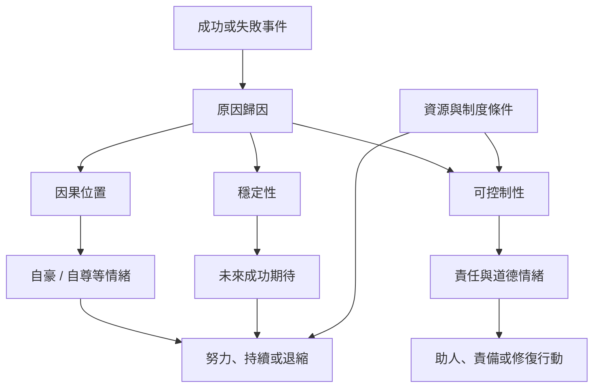

歸因不只解釋過去，也會改變未來期待、情緒與行動。Weiner 的模型分析原因的位置、穩定性與可控制性如何連結到希望、無望、自豪、羞愧、憤怒、感激與助人行為。歸因風格研究則將解釋習慣與習得無助及心理健康連結，但不能把社會困境簡化為個人認知問題。責任與責備還需要獨立的規範判斷。

可控制性必須回到真實資源與選項來理解；可解釋的原因不等於可責備的對象。

## 參考
* [[因果位置]]、[[穩定性]]、[[可控制性]]、[[成就動機歸因理論]]、[[歸因風格]]、[[習得無助]]、[[責任歸因]]、[[責備]]。
* [[成就歸因透過穩定性及可控制性影響期待情緒和行動]]、[[習得無助模型將穩定普遍內在歸因連到抑鬱脆弱性]]、[[疾病歸因的可控制責任與責備應分開評估]]。
* [[責任歸屬不能從可控制性直接推出]]、[[歸因會塑造同情憤怒責備與助人行為]]、[[公共援助制度應避免把受苦者的遭遇道德化]]。
