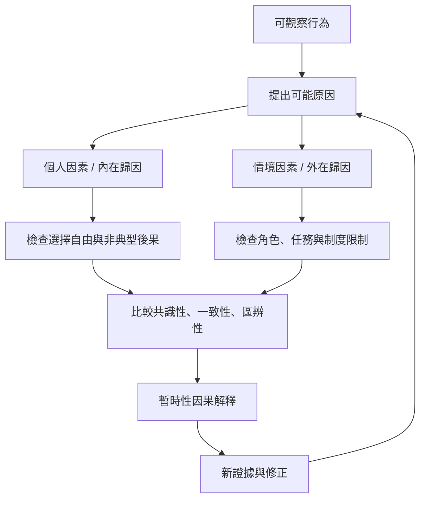

歸因研究的核心問題，是觀察者如何由可見行為推測不可見原因。Heider 提供個人力量與環境力量的基本框架；Jones 與 Davis 說明選擇、意圖與行為後果如何支持特質推論；Kelley 則要求比較共識性、一致性與區辨性，從多次觀察中判斷原因。

這張地圖把歸因視為可反覆修正的推論，而不是一次完成的人格判定。

## 參考
* [[歸因]]、[[因果歸因]]、[[歸因理論]]、[[內在歸因]]、[[情境歸因]]。
* [[對應推論理論]]、[[共變原則]]、[[共識性]]、[[一致性]]、[[區辨性]]。
* [[日常歸因把行為理解為個人與環境力量的結果]]、[[對應推論理論指出選擇與非典型後果提高特質推斷]]、[[共變模式要求比較行為者刺激與情境的一致性]]。
* [[觀察描述與原因推論應先分開再連結]]、[[共變資訊比單次印象更能約束因果推斷]]。
