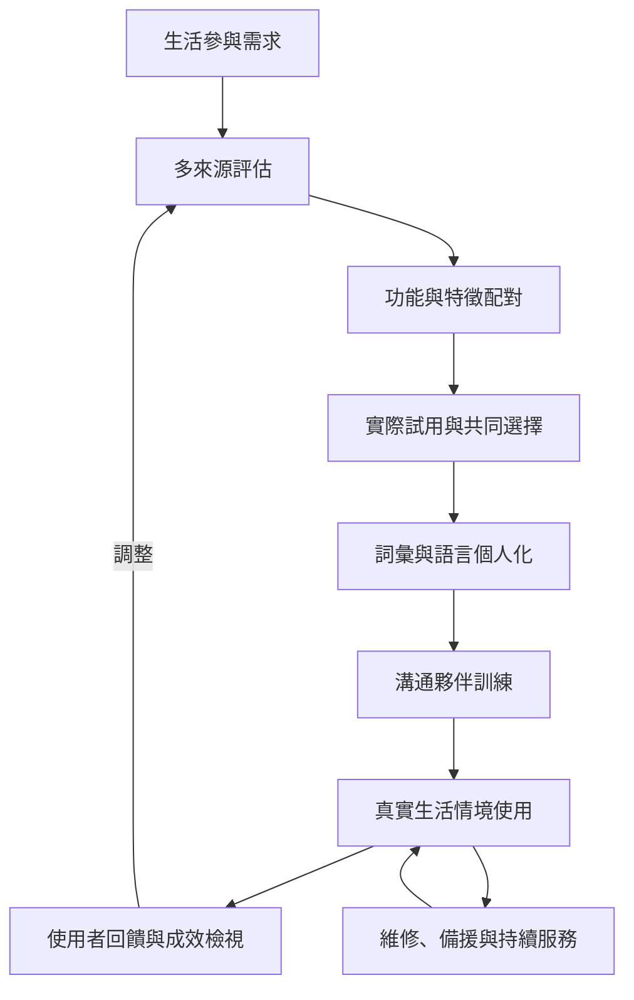

有效的 AAC 服務不是一次性挑選設備，而是持續的需求理解、試用、調整、夥伴訓練與生活情境追蹤。使用者的能力、偏好與環境會變動，因此流程需要循環。

## 連結
* 概念：[[輔助與替代溝通（AAC）]]、[[溝通夥伴訓練]]、[[使用者回報結果]]、[[直接選擇]]、[[間接選擇與掃描]]、[[眼控]]。
* 核心論點：[[AAC 評估應從生活參與需求出發]]、[[溝通存取方式必須配合動作能力與情境而調整]]、[[AAC 的可近性取決於整個服務系統]]。
* 在地研究：[[台灣國中小 AAC 服務研究指出跨專業合作與設備維護都很重要]]。
