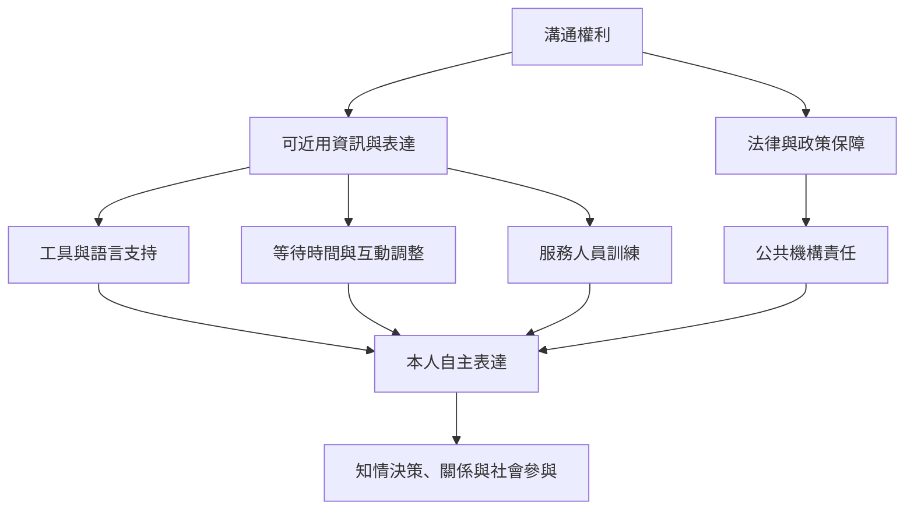

溝通權利需要在制度與日常互動中落實。當公共服務提供多種資訊格式、接受不同表達方式、提供足夠時間並訓練服務人員時，個人才有機會表達意見、取得資訊與參與社會。

## 連結
* 概念：[[溝通權利]]、[[溝通可近用]]、[[溝通自主性]]、[[等待時間]]。
* 核心論點：[[溝通可近用是公共服務的責任]]、[[AAC 使用者必須能表達拒絕與不同意]]、[[友誼與同儕互動需要雙向而非單向的溝通支持]]。
* 證據：[[《身心障礙者權利公約》第 21 條明確保障選擇溝通方式的自由]]、[[ISAAC 將溝通可近用定義為理解與表達都能被支持]]。
