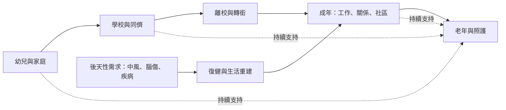

AAC 支持可能從幼兒期開始，也可能因中風、創傷、疾病或老化而在成年後出現。使用者的溝通方式與目標會隨生活階段、身份與情境變動，服務必須持續調整並維持跨場域連續性。

## 連結
* 概念：[[複雜溝通需求（CCN）]]、[[輔助與替代溝通（AAC）]]、[[使用者回報結果]]。
* 核心論點：[[AAC 支持必須延續到成年與老年生活]]、[[AAC 同時適用於發展性與後天性溝通需求]]。
* 證據：[[成人 AAC 使用者的居住、工作、友誼與服務參與仍受制度阻礙]]、[[中風後的溝通支持應同時使用溝通輔具、夥伴訓練與社區參與]]。
