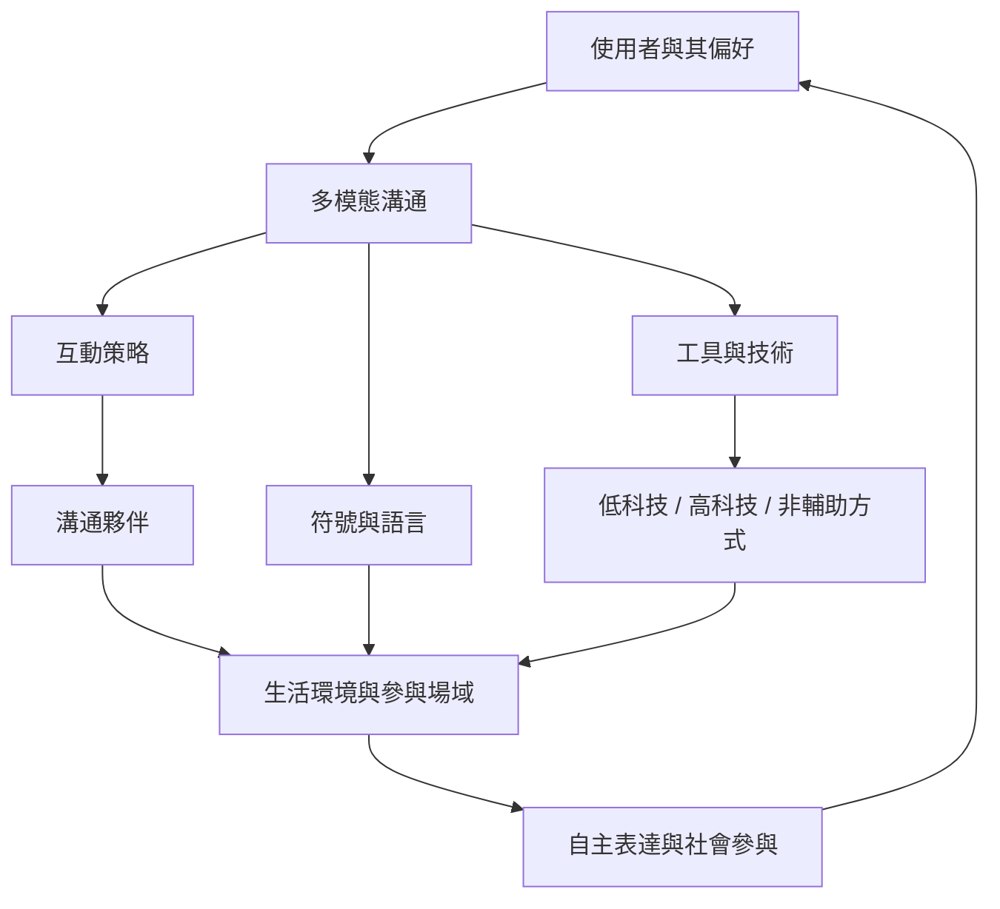

AAC 應被理解為使用者、溝通形式、工具、夥伴、環境與制度共同構成的生態系。任何一層不相容，都可能讓設備無法轉化為真正的溝通機會。

## 連結
* 概念：[[輔助與替代溝通（AAC）]]、[[多模態溝通]]、[[複雜溝通需求（CCN）]]、[[輔助溝通工具]]、[[低科技 AAC]]、[[高科技 AAC]]。
* 核心論點：[[AAC 是多模態溝通系統而不是單一設備]]、[[AAC 支持的是完整人格而不只是功能性需求]]、[[低科技與高科技 AAC 應形成可切換的連續系統]]。
* 證據：[[AAC 是涵蓋符號、工具、技術與策略的跨專業領域]]、[[WHO 與 UNICEF 指出輔助科技可近性仍存在巨大的全球落差]]。
