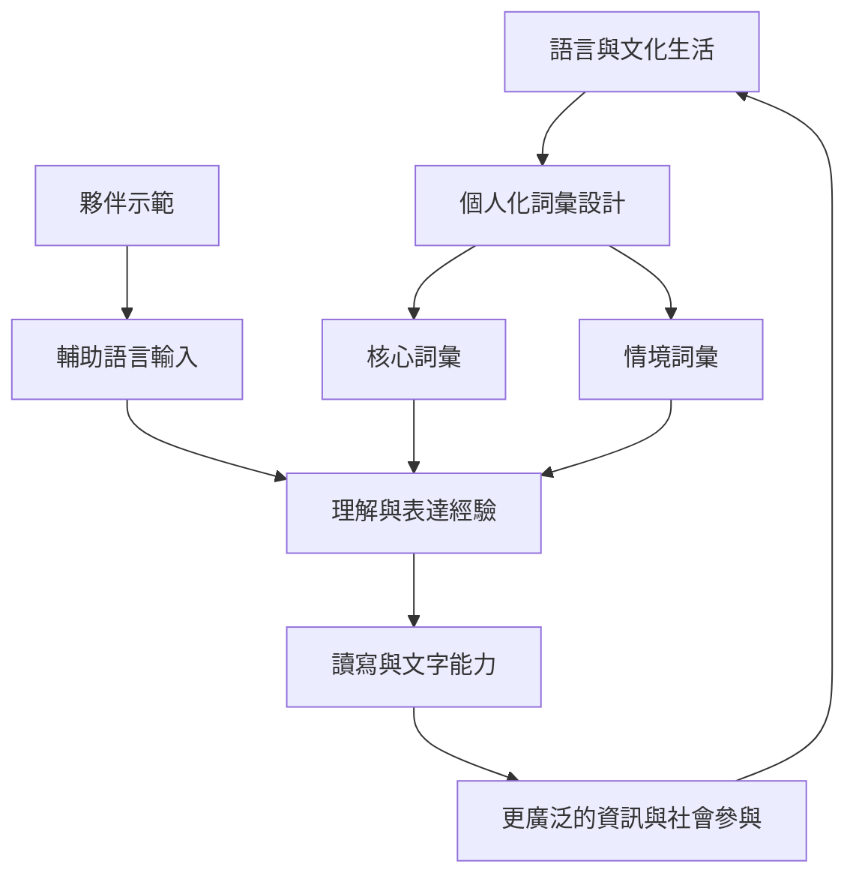

AAC 語言發展需要同時提供可理解的語言輸入、豐富且可擴充的表達工具、多語言支持與讀寫學習機會。詞彙系統既要能支援日常高頻互動，也要容納個人身份與生活世界。

## 連結
* 概念：[[核心詞彙]]、[[情境詞彙]]、[[個人化詞彙]]、[[輔助語言輸入（Aided Language Input）]]、[[雙語 AAC]]。
* 核心論點：[[核心詞彙與情境詞彙應共同構成可持續擴充的語言系統]]、[[AAC 詞彙必須反映使用者的語言與文化生活]]、[[AAC 使用者需要持續取得讀寫教學]]。
* 證據：[[讀寫能力是 AAC 使用者參與教育、工作與社區生活的重要條件]]、[[雙語 AAC 應支持使用者在兩種語言社群中完整參與]]。
