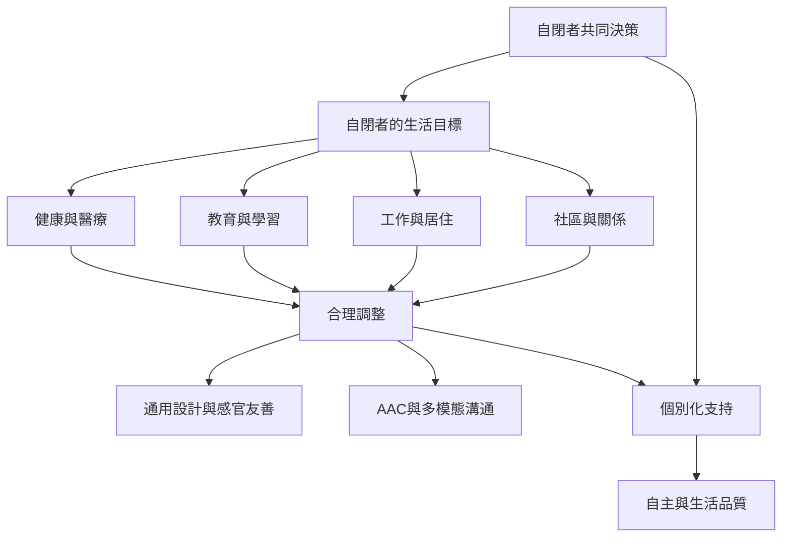

本圖以生活參與為中心，將支持方式分為環境設計、溝通可及性、醫療與教育服務、職場調整及共同決策。支持系統不是單一療法，而是跨場域的長期安排。

本圖連結 [[無障礙支持必須跨越醫療教育就業與社會照顧]]、[[介入成效必須同時評估自主權安全與生活品質]] 與 [[自閉者應參與影響自身生活的研究與政策]]。

## 思與行
* 用生命歷程檢查支持是否有斷點，尤其兒童服務轉向成人生活的階段。
* 共同決策要包含多種溝通形式、拒絕權與定期重新檢視支持的機制。

## 參考
* [[世界衛生組織估計全球自閉症盛行率約為每127人一人]]、[[AASPIRE研究指南提出讓自閉成人成為共同研究者的具體原則]]。
