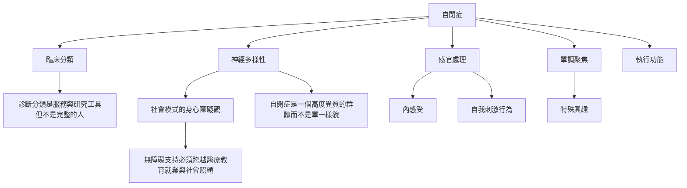

本圖整理自閉症的臨床描述、神經多樣性觀點、社會模式與不同注意力／感官理論。各種框架回答的問題並不相同：診斷分類協助辨識與服務，神經多樣性關注差異與權利，社會模式檢視環境障礙，單調聚焦等理論則提出理解經驗的假說。

閱讀時可交叉參照 [[自閉症是一個高度異質的群體而不是單一樣貌]]、[[診斷分類是服務與研究工具但不是完整的人]]、[[感官差異必須放回具體環境而非視為固定缺陷]] 與 [[單調聚焦理論把深度投入視為注意力配置而非單純缺陷]]。

## 思與行
* 避免把不同理論混成同一種「自閉症真相」；每個框架有不同目的與限制。
* 對每個理論追問：它解釋哪些經驗、忽略哪些人、是否有足夠實證？

## 參考
* [[WHO的ICD11診斷要求同時考量社會溝通與行為模式]]、[[單調聚焦理論將注意力興趣與自閉經驗連結為一種注意力配置方式]]、[[內感受統合分析未發現自閉成人心臟內感受準確度有顯著差異]]。
