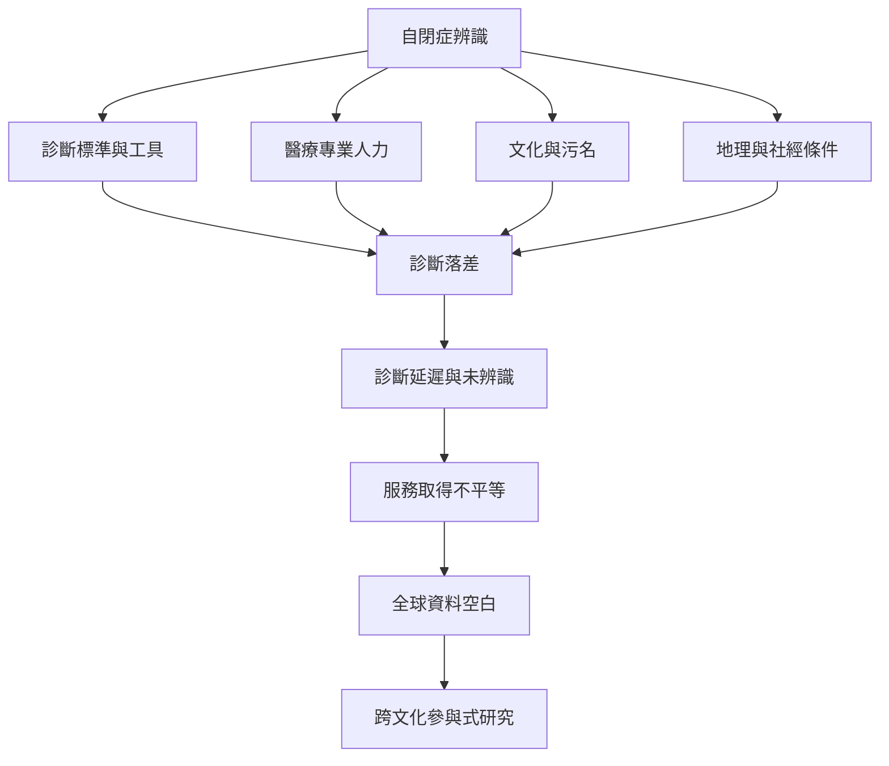

本圖從診斷標準延伸至服務可近性、文化、資源與資料品質。跨國數據需要放回診斷制度和人口監測設計中理解；低資料量地區不應被描述為沒有自閉者。

核心筆記：[[不同國家的診斷率不能直接當成真實盛行率比較]]、[[診斷落差往往反映制度門檻而不只是個體差異]]、[[文化與制度會改變自閉特徵被辨識的方式]]。

## 思與行
* 比較台灣、泰國、非洲及拉丁美洲資料時，逐一標示來源、時間、診斷工具和覆蓋範圍。
* 讓在地自閉者共同設計研究，避免外部工具直接取代在地經驗。

## 參考
* [[世界衛生組織估計全球自閉症盛行率約為每127人一人]]、[[台灣與泰國的自閉症辨識受到文化理解與專業資源共同影響]]、[[非洲自閉症研究指出專業資源匱乏與污名阻礙評估及支持]]、[[拉丁美洲自閉者與家庭面臨跨醫療教育及社會保障系統的服務斷裂]]。
