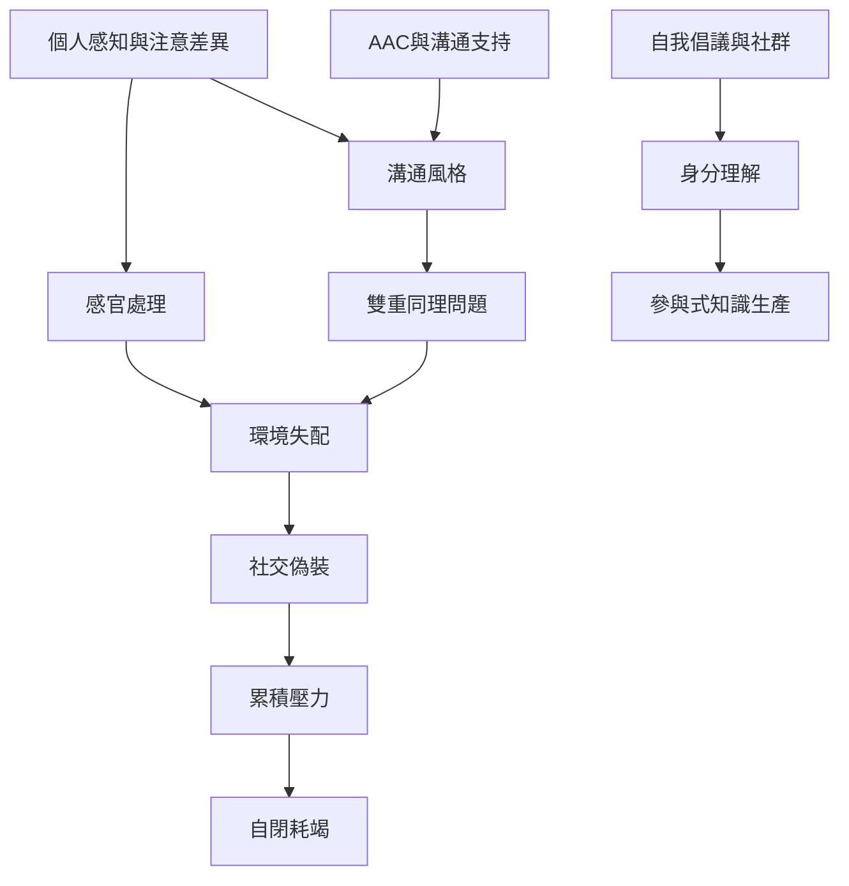

本圖將溝通方式、感官經驗、偽裝、耗竭與身分敘事連在一起。這些經驗並非每位自閉者都相同，也不一定以相同順序出現；圖中的箭頭表示可能的關係，而非必然因果。

可進一步閱讀 [[溝通障礙常是雙方與環境共同產生的結果]]、[[替代與輔助溝通是表達與參與權而非備用品]]、[[社交偽裝可能換取短期安全卻累積長期耗能]] 與 [[自閉耗竭常與長期壓力和支持不足有關]]。

## 思與行
* 在理解個人經驗時，詢問本人如何描述感官與溝通，而不是從外部行為直接推論。
* 對社群研究保留不同經驗的差異，避免把某個敘事變成新的典型。

## 參考
* [[自閉成人溝通回顧強調語言方式與互動環境都會形成障礙]]、[[偽裝經驗的質性綜整指出社會適應策略可能伴隨心理健康代價]]、[[自閉耗竭研究將長期壓力與能力期待失衡視為重要脈絡]]。
