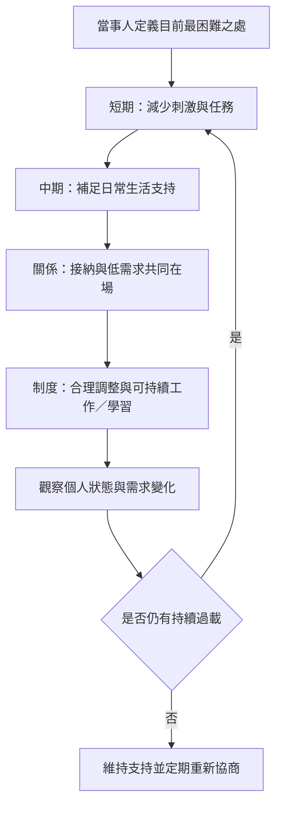

復原不是恢復到外界期待的標準表現，而是重新找到較能持續生活的條件。這通常包括降低不必要要求、調整感官環境、允許非同步溝通、提供日常任務支持、減少偽裝壓力與建立可拒絕的關係。不同人需要的獨處、互動與工作節奏不同，因此支持方案必須由當事人共同決定。

## 參考
* [[自閉症倦怠復原需要同時改變個人負荷與環境條件]]整理復原原則。
* [[建立由當事人選擇的低耗能支持協議]]、[[用低需求共同在場取代把社交重新當成復原作業]]及[[用可持續性而非表面產出設計友善工作與學習制度]]提供實作方向。
