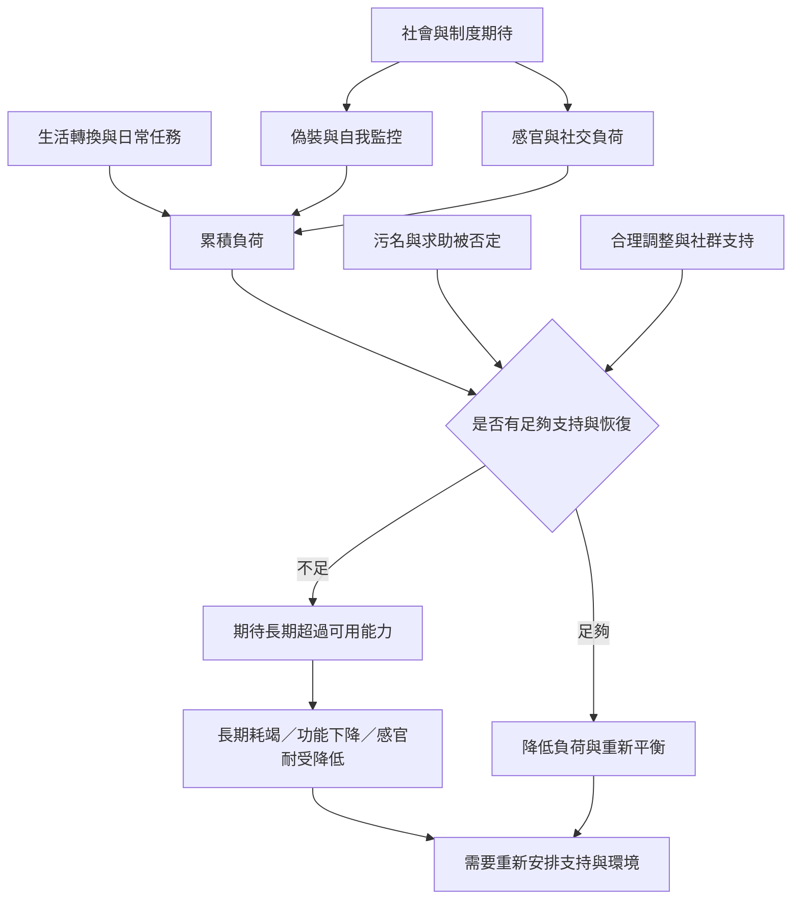

自閉症倦怠的形成可從「負荷累積—支持不足—能力與期待失衡」理解。偽裝、感官刺激、社交互動、轉換與制度要求會增加日常成本；若休息、調整與外部支持無法提供緩解，長期壓力便可能轉化為廣泛耗竭及功能改變。這張圖是概念模型，不是每個人的必經因果順序。

## 參考
* [[自閉症倦怠的形成需要同時分析壓力來源與支持障礙]]整合原始定義與風險模型。
* [[偽裝可能以短期適應換取長期耗竭]]、[[感官環境是日常負荷的重要來源而非背景噪音]]與[[合理調整透過改變環境降低長期不匹配]]是圖中的關鍵節點。
